<div align="center">

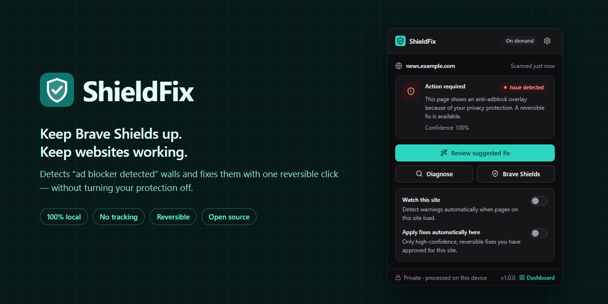

# ShieldFix

### Fix “Ad blocker detected” walls — without turning off your ad blocker or Brave Shields

A privacy-first browser extension for **Brave**, **Chrome** and other Chromium browsers that detects anti-adblock
popups, explains what’s going on, and removes the wall with **one reversible click**. Ads and trackers stay blocked.
Nothing leaves your device.

[](https://github.com/Dszae/ShieldFix/actions/workflows/ci.yml)
[](https://github.com/Dszae/ShieldFix/releases/latest)
[](LICENSE)
[](docs/ARCHITECTURE.md)
[](docs/TESTING.md)
[](PRIVACY.md)
[](CONTRIBUTING.md)
[](https://github.com/Dszae/ShieldFix/stargazers)

**[Install](#-install) · [Features](#-features) · [How it works](#-how-it-works) · [Privacy](#-privacy-by-design) · [FAQ](#-faq) · [Contributing](#-contributing)**

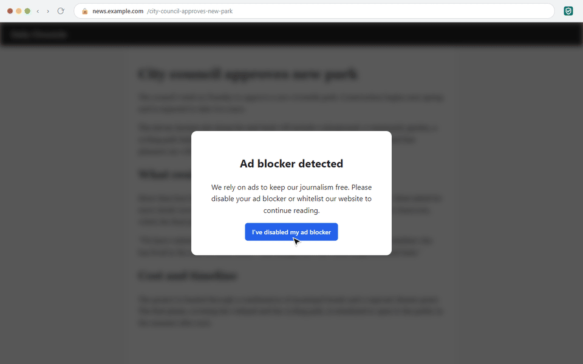

<sub>Recorded with the real extension on one of the project’s test pages.</sub>

</div>

---

## 🤔 The problem

You use an ad blocker or Brave Shields for privacy. More and more sites answer with a full-screen
**“Ad blocker detected — please disable your ad blocker to continue”** popup, blur the article, and lock scrolling.

Today your options are bad: turn your protection off, hunt for site-specific fixes, or install yet another blocker.

**ShieldFix gives you a better one:** keep your protection on, and fix the page — safely, reversibly, and only when you
say so.

<div align="center">
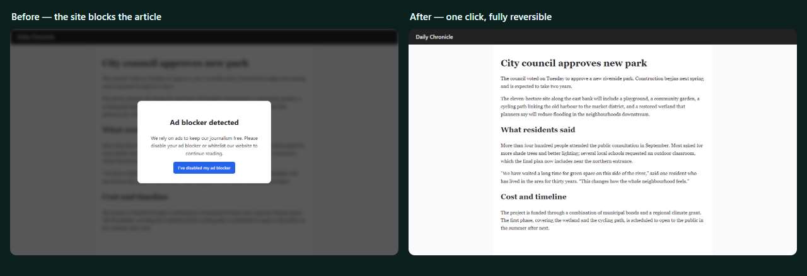
</div>

## ✨ Features

|     |                                     |                                                                                                                                                     |
| --- | ----------------------------------- | --------------------------------------------------------------------------------------------------------------------------------------------------- |
| 🔍  | **Smart anti-adblock detection**    | Combines warning wording, anti-adblock class names, overlay geometry, scroll locks, blur and “I’ve disabled it” buttons into a confidence score.    |
| 🛡️  | **No false alarms on real dialogs** | Cookie banners, sign-in forms, payment fields, paywalls, age gates and articles that merely _talk_ about ad blockers are recognised and left alone. |
| ↩️  | **One-click, fully reversible fix** | Hides the wall and its backdrop, restores scrolling, removes the blur. Nothing is deleted. **Undo** (or reload) restores the page exactly.          |
| ✋  | **You approve every change**        | Fixes are only offered at ≥ 90 % confidence and only applied when you click — or on sites where you said “always apply”.                            |
| 👀  | **Optional auto-detect**            | Watch the sites you choose and catch walls the moment they appear, with a small, accessible in-page notice.                                         |
| 📋  | **Compatibility rules**             | Per-site rules with versioning, rollback, expiry and JSON import/export. Rules contain no code; imported rules arrive disabled.                     |
| 🩺  | **Clear diagnostics**               | See exactly which signals matched, why a fix is (or isn’t) available, and which resources failed to load.                                           |
| 🦁  | **Brave Shields guidance**          | When a cosmetic fix isn’t enough, ShieldFix explains the per-site Shields setting — it never weakens protection on its own.                         |
| 🔒  | **100 % local**                     | No servers, no analytics, no account, no network requests. Ever.                                                                                    |
| 🌗  | **Polished & accessible**           | Light and dark themes, full keyboard support, screen-reader announcements, reduced-motion support.                                                  |

### Auto-detect on sites you choose

<div align="center">
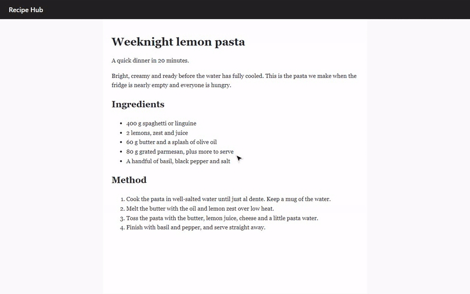
</div>

## 📸 Screenshots

<table>
  <tr>
    <td align="center">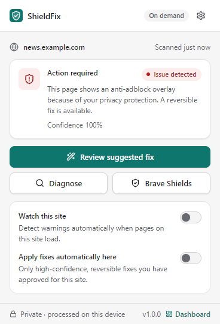<br><sub>Detects the wall</sub></td>
    <td align="center">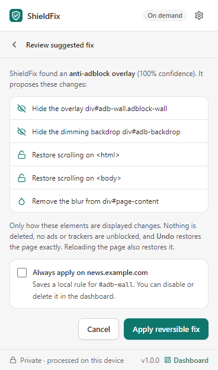<br><sub>Review before applying</sub></td>
    <td align="center">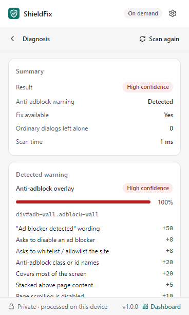<br><sub>See why</sub></td>
  </tr>
</table>

<table>
  <tr>
    <td>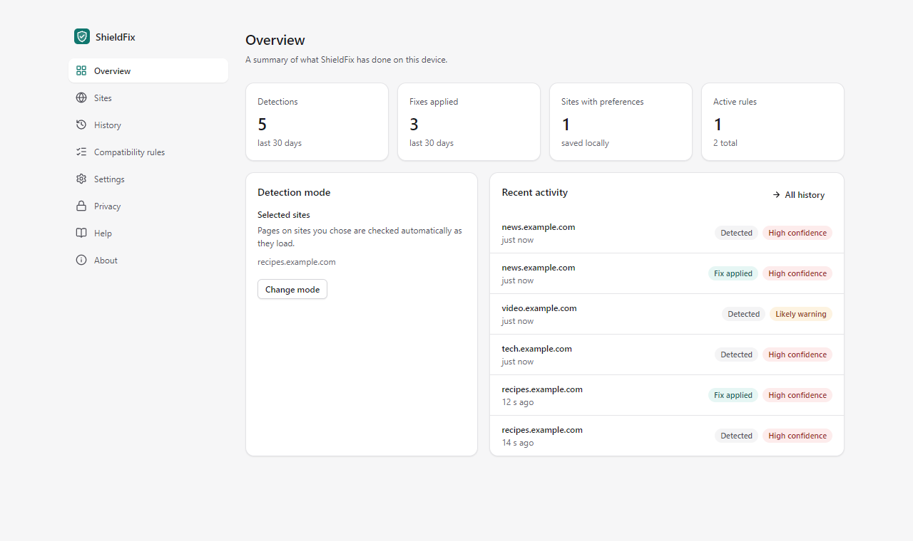</td>
    <td>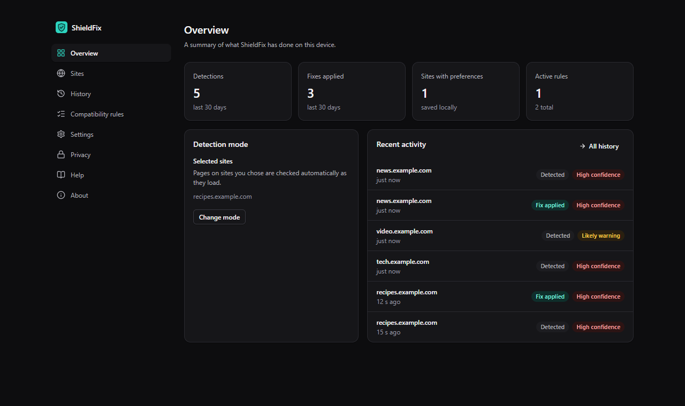</td>
  </tr>
  <tr>
    <td>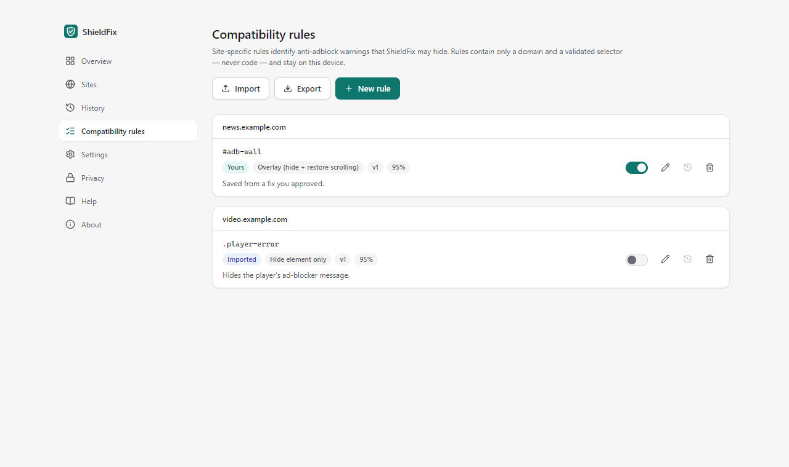</td>
    <td>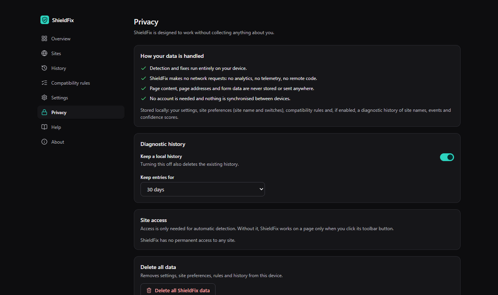</td>
  </tr>
</table>

## 🚀 Install

> ShieldFix is not on the Chrome Web Store yet. Until it is, install it in under a minute from a release:

1. Download **`shieldfix-<version>.zip`** from the [latest release](https://github.com/Dszae/ShieldFix/releases/latest)
   and unzip it into a folder you’ll keep.
2. Open your extensions page: `brave://extensions` · `chrome://extensions` · `edge://extensions`
3. Turn on **Developer mode** (top-right corner).
4. Click **Load unpacked** and select the unzipped folder (the one containing `manifest.json`).
5. Pin ShieldFix to your toolbar. A short welcome page opens — that’s it.

<details>
<summary><b>Build from source</b></summary>

```bash
git clone https://github.com/Dszae/ShieldFix.git
cd ShieldFix
npm install
npm run build        # outputs the extension to dist/
```

Then load `dist/` with **Load unpacked** as above. Requires Node.js 22.12+.

</details>

### Use it

1. Open a page that shows an anti-adblock popup and click the **ShieldFix** toolbar button.
2. Click **Review suggested fix** to see exactly what will change, then **Apply reversible fix**.
3. Tick **Always apply on this site** to make it automatic next time. **Undo** restores everything.

## ⚙️ How it works

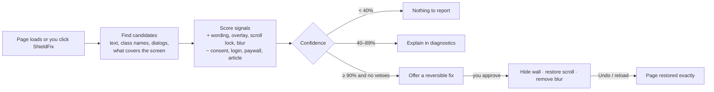

- **Hard vetoes:** anything containing a password field, payment fields, a form, consent choices, a subscription offer,
  age verification or the page’s main content is **never** hidden — no matter the score or rules.
- **Reversible by construction:** fixes only set inline styles and remember the previous values; nothing is removed
  from the page, so site scripts keep working.
- **Lightweight:** a scan takes about a millisecond on a typical page and a few milliseconds on a page with 7,000
  elements; monitoring caused no long tasks in our tests. See [measured performance](docs/TESTING.md#performance).

Deep dive: **[Architecture](docs/ARCHITECTURE.md)** — detection pipeline, scoring weights, design trade-offs.

## 🔒 Privacy by design

ShieldFix is built for people who care about privacy, so it holds itself to the same standard:

- ✅ **Zero network requests** — no analytics, telemetry, crash reporting or remote code.
- ✅ **No site access at install** — it only touches a page when you click it, or on sites you choose to watch.
- ✅ **No browsing history** — page addresses and content are never stored; history keeps only site names and is optional.
- ✅ **Open source & auditable** — strict Content Security Policy, validated messaging, no `eval`, no `innerHTML`.

Read the full **[privacy policy](PRIVACY.md)** and **[permission rationale](docs/PERMISSIONS.md)**.

## ⚖️ How ShieldFix compares

|                                       | Turn off ad blocker / Shields | Allowlist the site | **ShieldFix** |
| ------------------------------------- | :---------------------------: | :----------------: | :-----------: |
| Ads and trackers stay blocked         |              ❌               |         ❌         |      ✅       |
| Per-site, nothing global              |              ❌               |         ✅         |      ✅       |
| Explains what the page is doing       |              ❌               |         ❌         |      ✅       |
| Undo in one click                     |              ➖               |         ➖         |      ✅       |
| Works when the site withholds content |              ✅               |         ✅         |      ❌¹      |

<sub>¹ A cosmetic fix can’t restore content a site never loaded. In that case ShieldFix tells you, and shows how to
lower protection for that one site only.</sub>

## ❓ FAQ

<details>
<summary><b>Does ShieldFix work with Brave Shields?</b></summary>

Yes — Brave is the primary target and the full test suite runs in Brave. Extensions can’t change Shields settings
(there is no API for it), so ShieldFix never touches them. It fixes the page instead, and when that isn’t enough it
explains how to adjust Shields for a single site.
</details>

<details>
<summary><b>Which browsers are supported?</b></summary>

Brave and Chromium are tested automatically. Other Chromium-based browsers with Manifest V3 support (Chrome, Edge,
Opera, Vivaldi) should work but aren’t part of the automated test matrix yet. Firefox support is on the
[roadmap](ROADMAP.md).
</details>

<details>
<summary><b>Is this an “anti-adblock killer”? Does it bypass paywalls?</b></summary>

ShieldFix hides anti-adblock **walls** that are purely cosmetic — the overlay sitting on top of content you can already
load. It deliberately does **not** bypass paywalls, subscription prompts, logins or DRM: those are hard-vetoed in the
detection engine. It also doesn’t promise to defeat every anti-adblock script — when a site withholds content, it says
so honestly.
</details>

<details>
<summary><b>Will it hide something it shouldn’t?</b></summary>

It’s built to avoid that: fixes need ≥ 90 % confidence, every “ordinary” dialog type is vetoed, you review changes
before applying, and **Undo** restores the page exactly. If you ever see a wrong detection, please
[report a false positive](https://github.com/Dszae/ShieldFix/issues/new?template=false_positive.yml).
</details>

<details>
<summary><b>Does it collect any data?</b></summary>

No. There are no servers. Everything runs and stays in your browser — see the [privacy policy](PRIVACY.md).
</details>

<details>
<summary><b>Why does it ask for access to a site when I turn on “Watch this site”?</b></summary>

To detect walls automatically as pages load, the browser requires permission for that site. ShieldFix asks for that one
site only, and you can revoke it any time. Without it, ShieldFix still works whenever you click its toolbar button.
</details>

<details>
<summary><b>A site wasn’t detected. What can I do?</b></summary>

Open **Diagnose** in the popup to see what ShieldFix found, then
[report the missed warning](https://github.com/Dszae/ShieldFix/issues/new?template=missed_warning.yml) — only the site
name and the diagnosis are needed. You can also write your own rule in the dashboard.
</details>

## 🗺️ Roadmap

- [ ] Chrome Web Store and Edge Add-ons listings
- [ ] Firefox (Manifest V3) support
- [ ] Opt-in, signed community rule lists
- [ ] More languages for warning detection
- [ ] Detection inside embedded players and iframes

See **[ROADMAP.md](ROADMAP.md)** and vote with 👍 on [issues](https://github.com/Dszae/ShieldFix/issues).

## 🤝 Contributing

Contributions of every size are welcome — detection signatures, false-positive reports, translations, docs and code.

- Read the **[contributing guide](CONTRIBUTING.md)** (setup takes two commands)
- Pick a [good first issue](https://github.com/Dszae/ShieldFix/labels/good%20first%20issue)
- Ask questions in [Discussions](https://github.com/Dszae/ShieldFix/discussions)

```bash
npm install && npx playwright install chromium
npm run check       # types, lint, format, 190+ unit tests, build
npm run test:e2e    # real-browser tests on 10 scenario pages
```

Please follow the [Code of Conduct](CODE_OF_CONDUCT.md). Security issues: see [SECURITY.md](SECURITY.md).

## 📚 Documentation

[Architecture](docs/ARCHITECTURE.md) · [Permissions](docs/PERMISSIONS.md) · [Testing](docs/TESTING.md) ·
[Release process](docs/RELEASE.md) · [Privacy](PRIVACY.md) · [Security](SECURITY.md) · [Changelog](CHANGELOG.md)

## ⭐ Support the project

If ShieldFix saved you from switching your protection off, **[give it a star](https://github.com/Dszae/ShieldFix)** —
it helps other privacy-minded people find it. Sharing it with a friend who uses Brave helps too.

[](https://star-history.com/#Dszae/ShieldFix&Date)

## 📄 License

[MIT](LICENSE) © ShieldFix contributors

<sub>ShieldFix is an independent open-source project and is not affiliated with Brave Software, Google or any ad-blocking
project. “Brave” and “Chrome” are trademarks of their respective owners.</sub>
